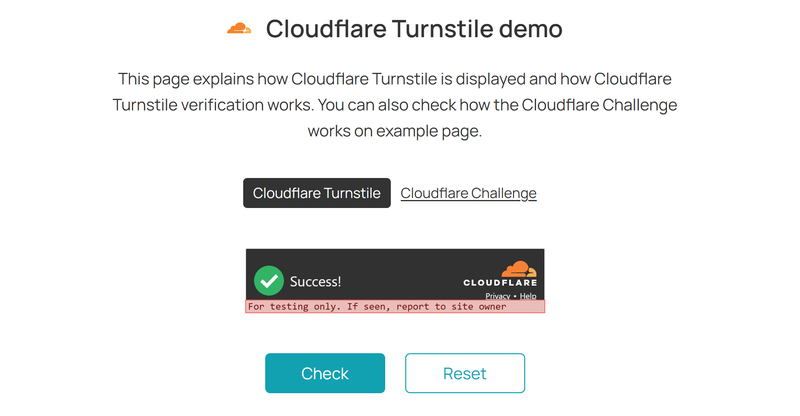
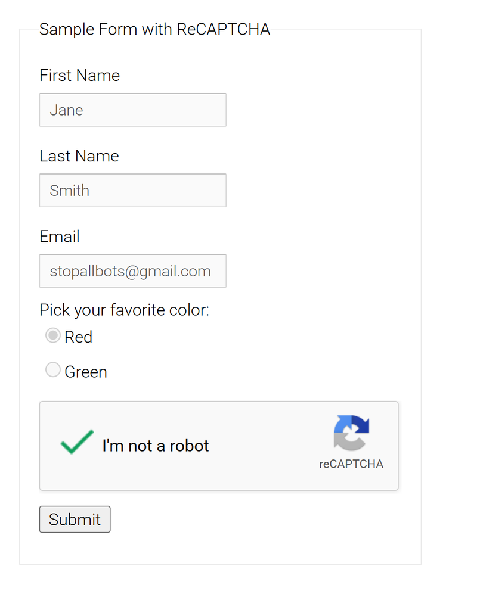
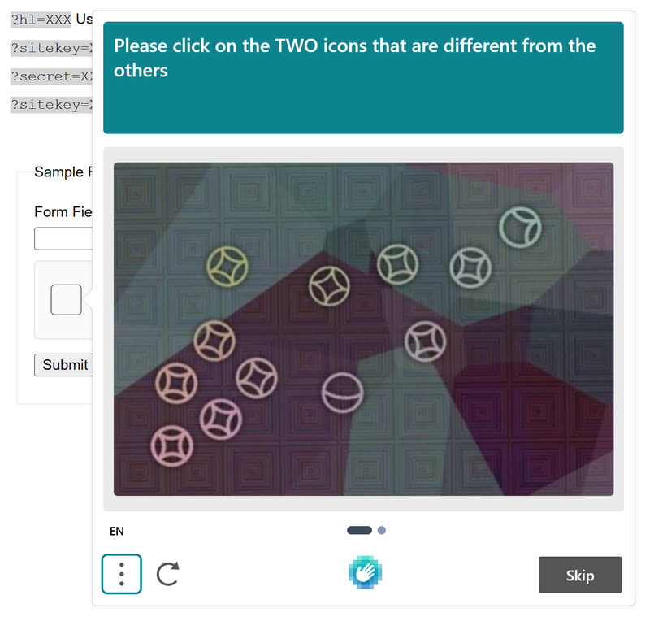

# Stealth Chrome DevTools MCP

[](https://pypi.org/project/stealth-chrome-devtools-mcp/)
[](https://github.com/DevinoSolutions/stealth-chrome-devtools-mcp/actions/workflows/test.yml)
[](https://www.python.org/downloads/)
[](LICENSE)
[](https://modelcontextprotocol.io)

> Undetectable browser automation for AI agents via the Model Context Protocol —
> one shared backend built for 50+ concurrent Claude Code sessions.

**Onboard your agent to Stealth Chrome DevTools MCP** — copy the sentence below
into any AI coding agent (Claude Code, Codex, Cursor, Windsurf, OpenCode, …) and
it installs the server, registers it in that agent, and verifies the backend:

```text
Fetch and execute the appropriate instructions to set me up for Stealth Chrome DevTools MCP from https://raw.githubusercontent.com/DevinoSolutions/stealth-chrome-devtools-mcp/main/agent-setup/prompt.md
```

The instructions it fetches are [`agent-setup/prompt.md`](agent-setup/prompt.md) —
readable by humans too. Signing in to websites stays yours: the agent prepares the
browser, you prepare the logins.

A self-contained **stealth Chrome DevTools MCP server** with smart profile management, anti-detection stealth arg filtering, and robust process lifecycle handling. Built on [nodriver](https://github.com/AminDhouib/nodriver) (CDP-based) for full anti-bot evasion.

---

## Demos

### Cloudflare Turnstile Bypass

https://github.com/user-attachments/assets/c4de61ae-6878-4fff-9bfd-65cdd4fadc2f

[Watch on YouTube](https://www.youtube.com/watch?v=dx2ksEI056U)

### Captcha Checkboxes, Clicked Automatically

Call `enable_captcha_auto_click(instance_id)` once, and the server handles captcha checkboxes on every tab of that browser. It watches for Cloudflare Turnstile, Google reCAPTCHA v2 and hCaptcha widgets and clicks the checkbox itself, with a trusted mouse click. There is no extension and no solver service. `get_captcha_status` lists every click it made.

These three screenshots come from a live run through the MCP on 2.1.62, one click on each widget:

| Cloudflare Turnstile | Google reCAPTCHA v2 | hCaptcha |
|---|---|---|
|  |  |  |
| Clicked, "Success!" | Clicked, ticked, token issued | Clicked; hCaptcha then asked for an image puzzle |

It clicks checkboxes only. It never solves image puzzles or sliders, and while a puzzle is showing it does not click. Whether a click passes is up to the captcha provider; hCaptcha, as above, often answers with a puzzle, which is left to you.

Speed is tested on every release, on Linux, Windows and macOS. The release is blocked if any of the three clicks comes more than 1 s after its checkbox is ready, or if a click the widget ignored is not tried again within 1.5 s.

### Persistent Login Sessions

https://github.com/user-attachments/assets/f81fc0c2-9233-48cd-8a9d-2577b1d33d57

[Watch on YouTube](https://www.youtube.com/watch?v=8w4ejfhTsLo)

---

## Key Features

- **Undetectable by anti-bot systems** — Cloudflare, DataDome, PerimeterX, etc.
- **Captcha checkboxes clicked for you** — Turnstile, reCAPTCHA v2 and hCaptcha checkboxes are clicked automatically once `enable_captcha_auto_click` is on; puzzles are never solved. See [the screenshots](#captcha-checkboxes-clicked-automatically)
- **Named sessions** — a session keeps its cookies and logins; new ones are seeded from `default`
- **Stealth arg filtering** — automatically strips 30+ detectable Chrome flags (Puppeteer/Playwright signatures, automation markers)
- **Multi-instance support** — spawn and manage multiple browsers simultaneously
- **Built for fleets of Claude Code sessions** — a session costs a thin stdio proxy
  (≈ 60 MB resident), not a browser: every session shares one backend per desktop,
  and a Chrome exists only where a session spawned one. Measured with 62 sessions
  attached at once; simultaneous cold start is scale-tested at 50 concurrent
  sessions, all usable in seconds against one backend — see
  [Built for fleets](#built-for-fleets-50-claude-code-sessions-one-backend)
- **A busy session re-attaches, and only then suffixes** — spawning with a `session` a live browser still holds joins THAT browser; `github-session` becomes `github-session-2` only when the re-attach declines
- **Orphan recovery** — safely cleans up leaked browser processes without killing live ones
- **Session persistence** — a new session carries the cookies, logins and Web Data of `default`
- **Zero idle timeout** — browsers stay alive until explicitly closed
- **Full CDP access** — DOM manipulation, network interception, JavaScript execution, screenshots

## Installation

### The right way — `uv tool install` (persistent, fleet-safe)

```bash
uv tool install stealth-chrome-devtools-mcp==2.1.68
```

This installs a version-pinned executable at `~/.local/bin/stealth-chrome-devtools-mcp`
(Windows: `%USERPROFILE%\.local\bin\stealth-chrome-devtools-mcp.exe`). Point your MCP
config (`claude_desktop_config.json`, `~/.claude.json`, etc.) at it:

```json
{
  "mcpServers": {
    "stealth-chrome-devtools-mcp": {
      "command": "C:\\Users\\<you>\\.local\\bin\\stealth-chrome-devtools-mcp.exe",
      "args": []
    }
  }
}
```

Claude Code one-liner (use the `.exe` path above on Windows):

```bash
claude mcp add --scope user stealth-chrome-devtools-mcp -- ~/.local/bin/stealth-chrome-devtools-mcp
```

**Why not `uvx` in the config?** It works, but `uvx` re-resolves the package on
**every client session start**. Each Claude Code session launches its own stdio
proxy, so a fleet of concurrent sessions (the shared backend is scale-tested at
50) turns startup into a package-resolution storm. A `uv tool install` gives
every proxy an instant, pinned executable — the shared backend, profile
handling, and per-session browser isolation behave identically.

To upgrade later: `uv tool install stealth-chrome-devtools-mcp==<new-version>`
(or `uv tool upgrade stealth-chrome-devtools-mcp` to track the latest release).

### Alternatives

Zero-install trial (fine for a first look, not for fleets):

```json
{
  "mcpServers": {
    "stealth-chrome-devtools-mcp": {
      "command": "uvx",
      "args": ["stealth-chrome-devtools-mcp==2.1.68"]
    }
  }
}
```

Or via pip (`pip install stealth-chrome-devtools-mcp==2.1.68`), then use the
`stealth-chrome-devtools-mcp` console script from that environment as the
`command`.

Crashes are reported to the maintainers by default, with your username and
machine name scrubbed out. See [Error Reporting](#error-reporting) for what a
report contains and how to turn it off.

### Local Development

```json
{
  "mcpServers": {
    "stealth-chrome-devtools-mcp": {
      "command": "uv",
      "args": [
        "--directory", "/path/to/stealth-chrome-devtools-mcp",
        "run", "stealth-chrome-devtools-mcp"
      ]
    }
  }
}
```

## How It Works

### Built for fleets: 50+ Claude Code sessions, one backend

The usual MCP browser server runs one server process and one Chrome per client
session. That is fine for one session and ruinous for fifty: every session pays
for a whole browser before it has done anything. This server is shaped
differently. A Claude Code session runs only a thin stdio proxy. The browsers
live in one shared backend per desktop, and a Chrome exists only where a session
asked for one.

Measured on a Windows 11 workstation (2026-09-11) with 62 Claude Code sessions
attached at once:

| | Measured |
|---|---|
| Claude Code sessions attached to the shared backends | 62 |
| Resident memory per session (its stdio proxy process tree) | ≈ 60 MB, ≈ 3.7 GB across all 62 |
| The same 62 sessions if each ran its own Chrome (≈ 750 MB per browser) | ≈ 46 GB |
| Backends on the machine | 3 — one per desktop context, plus headless |
| Live Chrome instances | 5 — only the ones sessions had spawned |
| Cold start: 50 sessions at once, every one usable (`initialize` + `tools/list`) | 7.3 s (`tests/test_startup_herd.py`) |
| A 51st session joining the warm backend | 1.0 s |

What that buys a fleet:

- **Memory scales with the browsers you use, not the sessions you open.** An
  idle session holds a proxy, not a Chrome. Sixty sessions with five browsers
  between them pay for five browsers and sixty proxies, not sixty browsers.
- **One cold start per backend.** The first session boots the backend under a file
  lock; every other session converges on it and is usable in seconds. A session
  that arrives later joins in about a second.
- **Nothing is left behind.** Orphaned Chrome processes are reaped without
  killing live ones, and a spawn that fails after Chrome launched cleans up its
  own browser.
- **Startup is not a package-resolution storm.** With `uv tool install` every
  proxy is a pinned executable, so fifty sessions starting together do not
  re-resolve the package fifty times.

The per-session and per-browser figures above are the ones to plan capacity
around. The backend's own footprint depends on what the sessions do with it
(captured network bodies, stored element clones, live tabs), so it is not quoted
as a constant.

### Sessions

A **session** is a named, persistent Chrome profile: `spawn_browser(session="acme")`,
or `stealthy spawn --session acme`. Ask for the same name again and you get the
same cookies and the same logins — and if a browser is still open on it, that
browser, not a new one.

**`default`** is the session you get when you name none. It is where a human
logs in, and every new session starts as a copy of it. `session="default"` opens
it explicitly. It is reserved: you cannot create a session of your own by that
name (nor by `master` or `master-snapshot`, which are the mechanism's own
directories).

**`seed_from` / `--from`** copies a NEW session from an existing one instead of
from `default`:

```console
stealthy spawn --session work --headed          # log in by hand in this window
stealthy spawn --session work2 --from work      # a second session, already logged in
```

It applies only when the session is CREATED. Passing it for a session that
already exists is an error that names where that session actually came from —
never a silent no-op, and never a re-seed over a login you typed by hand.

**The source may be open**, as long as its browser is one this backend is
driving — which it is if you spawned it (the example above leaves the `work`
window up). Its cookies are then read out of the running browser and written
into the new session, and the spawn says so:

```
seeded     : seeded from work at 2026-09-21 14:02
cookies    : 14 handed over from the running source
```

**That hand-off carries cookies and nothing else.** Every kind — session,
persistent, `HttpOnly`, `Secure`, `SameSite=None`, `Partitioned` — and it
carries every site the source is logged into, not only the one you meant. It
does NOT carry `localStorage`, `sessionStorage`, IndexedDB, Cache Storage,
service workers or saved passwords, so a site that keeps its token in
`localStorage` will not be logged in; for those, close the source first so the
file copy can read them. If the hand-off fails the session is still created and
still works — the answer then says `cookies : NOT carried (…)`.

A source open in a browser this backend does NOT drive — another backend's, or a
Chrome you started yourself — is refused by name, because there is no connection
of ours to ask it for its cookies and a file copy of a live profile carries none
at all.

**`--from default` — and an unset `--from`, which means the same thing — has
three outcomes**, because `default` is the session you log in to by hand and its
window is usually still open:

| the `default` window is | what you get |
|---|---|
| open, and this backend is driving it | the seed is copied **and** the live jar is handed over — `cookies : N handed over from the running source` |
| open in a Chrome we do not drive | the seed is copied, and nothing is refused. The seed is only as fresh as the last time that window was closed, which the `seeded` line tells you (`SEED CHANGED SINCE`) |
| closed | the seed is copied, as it always was |

The seed is a separate, closed, copyable form of `default` (below) and it is
refreshed when that window closes. The one case that IS refused is a machine
where no seed exists yet **and** `default` is open: there is nothing safe to
copy, and copying the live directory would hand you a session missing exactly
the logins you wanted. Close the `default` window once — that writes the seed —
and it works from then on, open or not.

```
C:\stealth-mcp-browser-sessions\
  master/              # the `default` session — your logins, cookies, extensions
  master-snapshot/     # its seed: a safe copy, refreshed while `default` is closed
  sessions/            # your named sessions, and disposable copies
    acme/
    acme-2/            # auto-suffixed when a browser already holds `acme`
```

The directory names are historical and are what you will see in a path; the
words you type and the words the tool answers with are `default` and the seed.

1. An unnamed spawn is **always** a disposable copy of the seed and never opens
   `default`, whether or not anything has it open (F-966); only
   `session="default"` opens it
2. Before opening `default` by name, the server refreshes its seed
3. When `default` is busy, a copy is made from the seed with its live jar handed over
4. Copies carry all cookies, logins, and session data. On a brand-new install
   there is no seed yet, so an unnamed spawn gets an empty copy and a
   `seed_warning` that says how to create `default`
5. A stale seed is auto-refreshed when auth files change
6. `--from <session>` copies a NEW session from that session instead

Whatever a session was copied from is recorded in it: `stealthy profiles` and a
spawn's own answer both print `seeded from <name> at <when>`, and flag
`SEED CHANGED SINCE` when the source has taken a login write since the copy was
made. A login done in one session still does not reach another on its own —
that is deliberate, and `--from` is how you ask.

Clones exclude regenerable Chrome caches, so each is a few MB rather than
multiple GB. Disposable auto-clones are deleted on close, and a storage cap
(`STEALTH_MCP_CLONE_STORAGE_CAP_GB`, default 10 GB) reclaims the oldest **idle**
clones if any ever leak — so `sessions/` stays bounded. Cap eviction is
**recoverable**: an evicted clone is moved into `sessions/.trash/` and only
purged after a retention window (`STEALTH_MCP_CLONE_TRASH_RETENTION_HOURS`,
default 24 h), so a mistaken eviction can be restored rather than lost.

Named profiles you create explicitly (e.g. `github-session`) persist and are
never deleted. But even a "persistent" profile is ~98% regenerable (caches plus
Chrome's multi-GB on-device AI model). So when `sessions/` exceeds
`STEALTH_MCP_BROWSER_SESSION_STORAGE_CAP_GB` (default 20 GB), the largest **idle** named
profiles are trimmed of those regenerable dirs while **every login is
preserved** — Chrome rebuilds them on next launch. In-use profiles are never
touched.

> **Shared-machine note:** the browser-session root defaults to `C:\stealth-mcp-browser-sessions`
> (drive root), which holds your logged-in cookies and session data. On a
> single-user machine this is fine. On a **shared multi-user** Windows box, other
> local users may be able to read it — point `STEALTH_MCP_BROWSER_SESSION_ROOT`
> at a location inside your user profile (e.g. `%LOCALAPPDATA%\stealth-mcp`) so
> the OS user ACLs protect it.

### The shared `fleet` session and the session lock

One signed-in browser that several agents work from, and that outlives all of them.

```text
spawn_browser(session="fleet")                 # first call creates it (a copy of the default seed)
spawn_browser(session="fleet", seed_from="upup-b9be57135713-84488-27")
                                               # or: make a browser that is ALREADY running the fleet
```

`fleet` is an ordinary named session, so everything named sessions promise holds:
`close_instance` keeps the profile, a backend restart re-attaches the browser under the
same `instance_id` (and restores `fleet` **first**), and nothing reaps it except
`kill-orphans --force`. A failed re-attach to `fleet` leaves its browser running and
recorded instead of reaping it, because the login in it cannot be re-created.

Asking for `fleet` while it is already open in this backend returns that instance with
`already_running: true` and the current `session_lock`; it is never walked to `fleet-2`
and never a copy. A spawn that names nothing is still never handed it. Closing it needs the
name too: `close_instance(instance_id=..., session="fleet")` (and `session="default"` for
`default`); without it the close is refused and the browser is left running, because other
chats work in it. If the running browser's
headless state differs from the `headless` you passed (the default `False` counts), the answer
adds `headless_mismatch`; a running browser cannot change it, so close it and spawn again. A
new session whose live cookie hand-off failed returns a top-level `seed_warning` (it is then
probably signed out), in addition to `seeded_via: "copy"` in `spawn_diagnostics`.

`seed_from` accepts any session **name** in the sessions directory, including the
`<name>-<n>` an agent's browser was walked to. If this backend drives the source, its live
cookie jar is carried over; if another process holds it, the request is refused by name.
Cookies only: no localStorage or IndexedDB from a running source (see `spawn_browser`).

**Make it the default source** for every new clone and new named session, instead of
`master-snapshot`: set `STEALTH_MCP_SEED_SESSION=fleet`. It is off by default. The
`fleet` session itself still bootstraps from the snapshot, and a misnamed value is refused
naming the setting. If the seed is held by a browser this backend does not drive, an
unnamed clone falls back to the snapshot with a `seed_warning`; an explicit `seed_from` or
a new named session is refused by name. Only the source rotates Google cookies (F-939);
clones, and a new named session seeded from a live browser, stay fenced.

**The lock is advisory.** Tool calls carry no caller identity, so a lock cannot stop another
agent's calls; it is the shared answer to "is somebody using this?".

| Tool | Purpose |
|---|---|
| `acquire_session_lock(owner, session="fleet", lease_seconds=300, wait_seconds=0)` | Take or renew (same owner) the lease. Refused with the holder and expiry when held. `lease_seconds` 1-3600, `wait_seconds` 0-120; out-of-range is refused, not clamped. |
| `release_session_lock(owner, session="fleet")` | Holder only; anyone else, or a free session, is refused. |
| `get_session_lock_status(session="fleet")` | `locked`, `holder`, `acquired_at`, `expires_at`, `expires_in_seconds`. |

Leases expire on their own and are held in memory, so a backend restart clears them.

### Stealth Arg Filtering

The server automatically strips Chrome flags that would compromise stealth:

| Category | Examples | Why Stripped |
|----------|----------|-------------|
| Automation signals | `--enable-automation`, `--test-type` | Sets `navigator.webdriver=true` |
| Fingerprint leaks | `--disable-gpu`, `--disable-webgl` | Detectable via WebGL/canvas probes |
| Puppeteer defaults | `--disable-backgrounding-occluded-windows` | Bot signature fingerprint |
| Playwright defaults | `--password-store=basic`, `--use-mock-keychain` | Bot signature fingerprint |

Stripped args are reported in `spawn_diagnostics.stealth_args_stripped`.

On Windows a spawn also launches with `--disable-features=CalculateNativeWinOcclusion`, so a headed window that other windows cover keeps `visibilityState` `visible` at Normal priority instead of being backgrounded (F-1010); the Puppeteer backgrounding switches above stay stripped.

### The backend's HTTP port is local-only and token-protected (F-1013, F-1018)

The shared backend listens on `127.0.0.1` and refuses what a web page could send it: a request whose `Host` is not a loopback name
(a DNS-rebound domain, `421`) or whose `Origin` is a foreign web origin (`403`). It also demands a per-user bearer token on every
request: the backend keeps one in `~/.stealth-mcp/backend.token` (readable by your OS user only; mode `0600`, or a single-user ACL on
Windows) and answers `401` without `Authorization: Bearer <token>`. The stdio proxy, `stealthy`, `doctor` and `status` read the file and
send it, so nothing changes for them. A raw `curl` or a `uvx` url-transport client must send the header itself. After upgrading, restart
Claude Code sessions that were open on an older release if they cannot reconnect. If you bind another address on purpose
(`--host backend.lan`), that name is allowed too; `--allowed-host NAME` (repeatable) adds a name such as a reverse proxy's.

The DevTools port of each browser it launches is a different matter: it listens on loopback (Chrome's default; the stealth filter strips `--remote-debugging-address` from `browser_args`) without a token and Chrome runs with
`--remote-allow-origins=*`, so any local process can drive a browser this tool started. That is by design for a single-user machine,
and the tool is not meant for multi-user hosts (RUNBOOK, "Local trust boundary").

### Login vault: sign in without the password reaching a model (T-19366)

A person stores logins once; an agent asks the backend to sign one in by label. **No password, passphrase, key or decrypted vault content reaches a model**: not in a tool argument or result, a log line, an error report, a network record or any CLI output, and there is no "show password" operation.

```bash
stealthy login init                                   # new passphrase, typed twice
stealthy login add work --site example.com --login-url https://accounts.example.com/signin --user me@example.com
stealthy login unlock --for 8h                        # puts the key in the backend's memory
```

Then an agent calls `list_logins()` (labels, sites, whether one is frozen; a username only if you passed `--show-username`) and `login(instance_id, label)`, which answers `logged_in`, `already_logged_in`, `needs_totp`, `needs_user`, `rejected` or `use_provider`. The sign-in happens in a tab the backend opens for itself: while it runs, every tool call naming that tab is refused, `execute_cdp_command` and `switch_tab` are refused for the whole browser, hooks and network capture never arm it, and the tab is closed afterwards. The session is saved in the profile, so reload your own tab.

- **Where it is kept.** `~/.stealth-mcp/vault.json`, scrypt + AES-256-GCM, labels and sites encrypted too. The key is derived on your machine from a passphrase typed at a terminal (`unlock` and `init` refuse a pipe or a script) and exists only in the backend's memory until `lock`, the `--for` period or the backend exits. Passwords are only ever a hidden prompt or `--password-stdin`, never an argument or an environment variable.
- **Where it types.** Only on `https` and a host exactly in the entry's `hosts` (default: the login URL's host), checked from the browser's own frame tree before every field. A browser started with a proxy or a host-resolver, certificate, same-origin or extension switch (in any spelling Chrome accepts), or whose environment, profile flags or machine policy do the same, is refused. No page the agent can use reaches Chrome's DevTools endpoint.
- **After a refusal.** One `rejected` freezes that entry until `stealthy login edit` clears it, so an agent cannot retry a wrong password into an account lockout. `stealthy login audit` lists every attempt (no secret, no username).
- **Defence in depth.** Registered passwords, plain and URL-encoded, are also masked in Sentry events, log lines (tracebacks too) and the debug view and export, and a release-gate test searches all of them after a real login.
- **DevTools.** A page cannot reach Chrome's debug port, and no tool can load a DevTools window or `chrome://inspect` (`navigate` and `new_tab` refuse them, whatever the spelling: percent-encoded, upper-case, with a port or userinfo, behind `about:` or `view-source:`, with a soft hyphen or an ideographic full stop in the host); one that appears anyway (a headed person's F12, `execute_cdp_command`) is hidden from every tool, and the login closes it, or refuses to type if it cannot, before it types a field. **A login therefore closes every DevTools window open in that browser**; the result says how many (`closed_devtools_windows`, counted for that browser only; a login never closes a window in another browser). If the guard's connection to the browser drops, the windows it knew stay barred and a login in flight stops, clearing what it typed. Marks on `chrome://` and `file:` pages also stay while the browser is alive, and nothing updates them after the guard ends, so a page that later navigates to one of those is not barred by the guard (the URL tools still refuse to load them); the marks of a browser that is gone are dropped, and the bars on DevTools windows of a dead browser are not.
- **While a login runs.** Every browser-internal page (`chrome://`, `chrome-extension://`, `chrome-untrusted://`, `devtools://` and the like) is hidden from `list_tabs`, refused by every tool and cannot be loaded by `navigate` or `new_tab`; `about:blank` and the new-tab page still work, and outside a login `chrome://` pages are ordinary. `go_back` and `go_forward` are refused for the duration too.
- **Vault mode.** The agent's tools are an unusually large surface: some run code, some write files where code loads, some read any file. So while a vault file exists (locked or unlocked) **every raw or unbounded capability is refused in every backend**, from one list (`embedded/vault_mode.py`), with a message that names the vault and `stealthy login destroy`; with no vault each of them behaves exactly as before. Refused: (1) `create_python_binding` and `create_dynamic_hook`, which run the caller's Python inside the backend with its authority; (2) `execute_cdp_command` (raw CDP can point Chrome's downloads at any folder, read a local file into a page or load code, and no list of methods is safe; `list_cdp_commands` still works); (3) `spawn_browser(browser_args=...)` switches other than `--window-size`, `--window-position`, `--start-maximized`, `--lang`, `--accept-lang`, `--user-agent` and the one value `--disable-blink-features=AutomationControlled` (and http(s) start pages; the other feature-list switches `--disable-features`, `--enable-features` and `--enable-blink-features`, and any other value of `--disable-blink-features`, are refused, because the feature names are an open list that includes site isolation and private-network protections), because Chrome has switches that write a file you name (`--log-file`) or start a program (`--renderer-cmd-prefix`, `--gpu-launcher`), and `user_data_dir` as a path (a session NAME still works); (4) `file:` URLs in `navigate`, `new_tab` and `create_simple_dynamic_hook`, and any tab that reaches one, which is hidden and blanked like an inspector (a page there could read `vault.json`); (5) a pickle export (`export_debug_logs` writes JSON in the mode); (6) a download folder of the page's choosing: every browser a backend drives is pinned to `~/Downloads/stealth-mcp-downloads` under generated names, re-asserted every five seconds (the same pass hides a `chrome://` page that was already open when the vault appeared; until the pass reaches that page, a tool called with no `tab_id` can still act on it, and a pass takes more than its five seconds' interval to arrive when the machine is slow: seconds on a cold one, 11 s measured for a first pass), so a page cannot save `evil.pth` anywhere. Two limits, stated plainly: a browser that was already running when the vault appeared can still hold its old download folder for up to five seconds (no tool can change it in that window; page script could still start a download), and it keeps whatever launch switches it was started with (a proxy, `--remote-allow-origins=*`, an old `--user-data-dir` path): the mode pins its downloads and bars `file:` pages, it does not rewrite the browser; (7) `chrome://`, `chrome-untrusted://` and `devtools://` pages: hidden from the tools and refused by every URL tool, always, and a call that names no `tab_id` is refused when the tab it would act on is one a person left current (call `new_tab`, or pass the `tab_id` of a tab you opened); the new-tab page and `about:blank` work. A tab the backend cannot identify is refused the same way, so in vault mode a call with no `tab_id` can fail until you call `new_tab`. Such a page can send commands to the browser itself. JavaScript-only tools (`execute_script`, `inject_and_execute_script`, `create_persistent_function`, `execute_python_in_browser`, which compiles to JavaScript) and `create_simple_dynamic_hook` stay available. `stealthy login init` lists all seven before it asks for a passphrase and **refuses while any backend this machine knows has already run caller Python, or cannot say** (an older release, a process that does not answer, an unreadable `server.json`: restart it, then run `init` again); `unlock` and `status` run the same check, `status` prints `vault mode: ON` and each restriction, and `stealthy login destroy` locks every backend and deletes the vault, which turns the mode off. **Older releases:** a backend of a release before vault mode has no gate at all, so restart every backend on this release before you create a vault and after you upgrade with one; until then that backend still has the Python tools. **What this does not cover:** The guarantee is against an agent that has only this MCP's tools. If caller Python ever ran on this machine before the vault was created, or the agent has any other way to run code as the same OS user (a shell tool, for example), nothing here can protect the vault from what that code left behind.
- **A site that shows its form again.** A site that keeps showing its login form after a sign-in that worked reads `needs_user`; only a form that comes back in a new page, or a new error message, counts as a refused password (and freezes the login).
- **Files the tools read and write.** `export_debug_logs`, `export_network_data` and `take_screenshot` never write a file the machine would run: not into any Python `sys.path` or site directory (the working directory excepted), the Python and virtual-environment trees, this package, OS startup folders or shell and PowerShell profiles, and never a file named like code (`.pth .py .pyc .pyd .so .cmd .bat .ps1 .sh .lnk .exe .dll .vbs .js .desktop .plist` and the like, in any case, with Windows' trailing dots and stream names folded); `upload_file` and `import_network_data` read nothing in a credential store, a browser profile or this server's state. These rules apply with or without a vault. The check resolves dozens of paths, so it runs on a worker thread and never stalls the backend.
- **Not covered.** The signed-in session itself (an agent in a logged-in browser can act as you); any process running as your OS user, which can read the backend's memory or open Chrome's debugging port directly on the loopback interface (the guard keeps agent tabs out of it, not local processes); extensions installed in the profile and the operating system's own proxy and certificate store; your username, which Chrome's autofill may keep in the profile's `Web Data` (the password is never written to the profile); login flows that are not username-then-password (they return `needs_user`); two-factor completion and the "sign in with Google" account chooser (a later phase: `use_provider` only makes sure the provider account is signed in). `--disable-logins` removes the two tools.

### Orphan Recovery

On server restart, the process cleanup system:

- Reaps only browsers whose **owner backend is dead** — every tracked browser records
  which backend started it, so two backends running side by side never reap each
  other's browsers
- Keeps `create_time` tracking as a second net: never kills a process that started
  **after** the current server session began
- Safely handles `psutil.AccessDenied` on Windows elevated processes

### Headed Browsing and Where the Window Opens

A headed browser appears on the desktop of whichever process **launched** it, not
of whichever session asked. Because sessions share a backend, a backend that was
first started from an SSH login or a Windows service session cannot show a window
to anyone — including the sessions running on the physical desktop.

So the backend is keyed by **display context**: one per desktop, plus one for a
headless context. Discovery prefers a backend that can show a window, which means
an SSH-driven `spawn_browser(headless=False)` automatically uses the desktop
backend and its window opens on the real screen. Where no such backend exists, the
spawn **raises** instead of handing back an invisible browser; run
`stealth-chrome-devtools doctor` to see which contexts have a backend. Headless
spawns work from anywhere.

## Usage Examples

```python
# A disposable copy of the shared default session (what you get when you name none)
spawn_browser()

# A named session, with login persistence
spawn_browser(session="github-session")

# Same name while a browser still holds it → re-attached to THAT browser
spawn_browser(session="github-session")

# Headless with stealth (bad args auto-stripped)
spawn_browser(headless=True, browser_args=["--enable-automation"])
# → stealth_args_stripped: ["--enable-automation stripped: sets navigator.webdriver=true"]
```

## MCP Tools

| Tool | Description |
|------|-------------|
| `spawn_browser` | Launch a new stealth browser instance |
| `navigate` | Navigate to a URL |
| `take_screenshot` | Capture page screenshot |
| `execute_script` | Run JavaScript in page context |
| `query_elements` | Find DOM elements by CSS selector |
| `click_element` | Click on an element |
| `type_text` | Type text into an input |
| `get_page_content` | Get page HTML content |
| `list_instances` | List all active browser instances |
| `close_instance` | Close a specific browser |
| `list_network_requests` | View intercepted network traffic |
| `get_cookies` / `set_cookie` | Manage browser cookies |
| `enable_captcha_auto_click` / `disable_captcha_auto_click` | Click Turnstile, reCAPTCHA v2 and hCaptcha checkboxes automatically |
| `get_captcha_status` | Whether the auto-clicker is on, and every click it made |

**102 tools** across 14 sections — the count is derived from the live tool registry,
never hand-maintained. [See the full navigation map →](NAVMAP.md).

That is what the server **serves**, which is not the same as what the release
gate **proves**. At the release SHA in the evidence ledger, 3 of those 102 are
release-qualified: asserted end-to-end over the real stdio transport a client
actually speaks. The rest are driven against real Chrome by the E2E suite but
through an in-process seam, so they are `served-unqualified` at the wire — tested,
not proved there. [`RELEASE_CONTRACT.md`](RELEASE_CONTRACT.md) lists the state of
each tool and is the only source for those numbers.

## Testing

```bash
# Unit tests only (no Chrome needed)
uv run pytest -m "not integration"

# All tests (needs Chrome installed)
uv run pytest

# Verbose with short tracebacks
uv run pytest -v --tb=short
```

> If your checkout path contains spaces or an `&`, `uv run pytest` fails with
> `Failed to canonicalize script path` — use the venv Python directly:
> `.venv\Scripts\python.exe -m pytest -m "not integration"`. See
> [CONTRIBUTING.md](CONTRIBUTING.md) for the full test/gate workflow.

A comprehensive suite covers stealth arg filtering, profile resolution, orphan recovery, storage-cap sweeps, the ops CLI, and full browser integration.

## Environment Variables

All optional. Defaults work for normal use. Set them in your shell, or in
`~/.stealth-mcp/.env` — every key is documented in [`.env.example`](./.env.example).

A `.env` in your **project** directory is deliberately ignored. The backend is a
shared process launched with whatever folder your MCP client had open, so
reading the project's `.env` meant reading someone else's application config —
which crashed the server outright on an ordinary `DATABASE_URL` and silently
adopted that app's `PORT`, `DEBUG`, and `SENTRY_DSN` as the server's own.

| Variable | Default | Purpose |
|----------|---------|---------|
| `STEALTH_MCP_BROWSER_SESSION_ROOT` | `C:\stealth-mcp-browser-sessions` (Win) / `~/.stealth-mcp-browser-sessions` (Unix) | Base folder for profiles |
| `BROWSER_MASTER_USER_DATA_DIR` | `<root>/master` | the `default` session's directory (name is historical) |
| `BROWSER_MASTER_SNAPSHOT_DIR` | `<root>/master-snapshot` | its seed: what a new session is copied from |
| `BROWSER_PROFILE_CLONE_ROOT` | `<root>/sessions` | Folder for profile copies |
| `STEALTH_MCP_CLONE_STORAGE_CAP_GB` | `10` | Cap on total auto-clone storage; oldest **idle** clones are reclaimed when exceeded (`0` = disable). Named profiles and in-use clones are never touched. |
| `STEALTH_MCP_BROWSER_SESSION_STORAGE_CAP_GB` | `20` | Cap on total `sessions/` storage; when exceeded, the largest **idle** named profiles are trimmed of regenerable cache/model dirs — logins kept (`0` = disable). *(Renamed from `STEALTH_MCP_SESSION_STORAGE_CAP_GB`; update your config — the old name is no longer read.)* |
| `STEALTH_MCP_CLONE_TRASH_RETENTION_HOURS` | `24` | How long a cap-evicted clone stays recoverable in `sessions/.trash/` before purge (`0` = purge on next sweep). |
| `STEALTH_MCP_CLONE_OUTPUT_DIR` | `~/.stealth-mcp/element_clones` | Where screenshots, large-response spills, and element-clone files are written. Kept in a per-user dir (never inside the installed package) so a read-only `site-packages` can't break captures. |
| `BROWSER_IDLE_TIMEOUT` | `0` | Idle cleanup timeout (`0` = disabled) |
| `STEALTH_CHROME_PROFILE_KEY` | unset | Force a stable clone key |
| `STEALTH_MCP_CLIENT_ROOTS_TIMEOUT_SECONDS` | `5` | Deadline for the `roots/list` request the auto-clone path sends to the MCP client to name a clone. MCP `roots` is optional, so a client may never answer; on expiry the clone name falls back to `CODEX_WORKSPACE`/`CLAUDE_PROJECT_DIR`/`PWD`/cwd (`0` = never ask). |
| `STEALTH_BROWSER_DEBUG` | `false` | Enable debug logging |
| `STEALTH_MCP_NO_ERROR_REPORTING` | `false` | Set to `true` to disable [error reporting](#error-reporting) |
| `STEALTH_MCP_NO_PERSIST_SESSION_COOKIES` | `false` | Logins are kept by default (F-937). Persistent profiles (the `default` session and named sessions) get the Chrome pref `session.restore_on_startup=1` set through `chrome://settings` (once per profile, in the background after the spawn has returned; a profile that already has it is not touched), which is the only thing that makes Chrome write **session cookies** (Apple ID, Xero, Walmart Seller, ...) to disk at close; the saved tabs it would then restore are deleted before each launch and never copied into a clone or seed, so a spawn still opens on one `about:blank`. Set to `true` to not set the pref; a profile that already has it still gets its saved tabs removed before each launch (otherwise the next launch would reopen them). |
| `STEALTH_MCP_NO_DISABLE_DBSC` | `false` | Google stays signed in by default (F-937): Chrome launches with Device Bound Session Credentials disabled (`--disable-features=` `EnableBoundSessionCredentials`, `DeviceBoundSessions`, `DeviceBoundSessionsFederatedRegistration`, `DeviceBoundSessionsForRestrictedSites`, `EnableBoundSessionCredentialsContinuity`, `EnableChromeRefreshTokenBinding`, `EnableChromeRefreshTokenBindingUpgrade`, `EnableCookieBindingCookieUpgrade`, merged into the one `--disable-features` switch Chrome honors, next to nodriver's own). Their TPM-bound `__Secure-1PSIDTS` / `__Secure-3PSIDTS` cookies do not survive a relaunch, which signed the account out. Set to `true` to launch without the switch. |
| `STEALTH_MCP_ALLOW_BROWSER_SIGNIN` | `false` | Chrome's own sign-in is off by default (F-938): every spawn (master, named session, auto-clone, delegated desktop launch) passes `--allow-browser-signin=false`, so Account Consistency is `None` and the account reconcilor `Inactive`. With it on (stock `DICE`), a clone or seed carries Google cookies but no token in the token service, and the reconcilor logs those cookies out server-side, which signs the master out too. Web sign-in to Google still works. A caller's own `--allow-browser-signin=...` in `browser_args` wins. Set to `true` to launch without the switch. |
| `STEALTH_MCP_ALLOW_CLONE_GOOGLE_ROTATION` | `false` | Clones never rotate Google session cookies (F-939): on every target of an auto-clone, requests made from tabs, popups, iframes and workers to `accounts.google.com` / `accounts.youtube.com` `/RotateCookies*` and `/RotateBoundCookies*` are failed (the requests a page makes, redirect hops and workers included; a document load of one is NOT failed, whether an iframe's, a popup's, a new tab's, a top-level navigation or a form-POST navigation, and the POST the `RotateCookiesPage` script makes is what is blocked. Not established: whether a document load of RotateCookiesPage rotates the pair by itself.), so only the master rotates. Many clones rotating one copied session fork its `__Secure-*PSIDTS` chain and Google revokes the session everywhere. `true` lets clones rotate. |
| `STEALTH_MCP_NO_LIVE_MASTER_SEED` | `false` | A clone spawned while the shared (master) session is open in a browser this backend does not drive gets the master's LIVE cookies over its loopback debug port (F-939), not the stale `master-snapshot`. `true` restores the refusal. |
| `STEALTH_MCP_SEED_SESSION` | _(empty)_ | Copy every NEW clone and NEW named session from this session (e.g. `fleet`) instead of `master-snapshot` (F-952). Its live cookies are handed over when this backend drives it. Empty keeps the snapshot. A name that does not exist is refused naming this setting. |
| `STEALTH_MCP_LOG_LEVEL` | `INFO` | Minimum level the file logger records (`DEBUG`, `INFO`, `WARNING`, ...). An unrecognized value falls back to `INFO` instead of failing startup. |
| `STEALTH_MCP_LOG_DIR` | `~/.stealth-mcp/logs` | Where the file logs and freeze dumps are written ([RUNBOOK](RUNBOOK.md#where-the-logs-are)). |
| `STEALTH_MCP_NO_AUTO_RECOVERY` | `false` | Internal. Skips the startup orphan-browser recovery and signal-handler install, in-process only: the `stealthy` CLI's read-only commands set it themselves so running them never reaps a live backend's browsers, and it also applies to `serve` and `--standalone`. A backend spawned for the proxy ignores it (it is removed from the child's environment). You should not need to set it. |
| `STEALTH_MCP_NETWORK_CAPTURE_BODIES` | `false` | Capture response bodies for `get_response_content` (metadata is always captured). Off by default; bounded by the two byte caps below. |
| `STEALTH_MCP_NETWORK_BODY_MAX_BYTES` | `5242880` (5 MiB) | Per-body cap when body capture is on, in bytes; a larger body is not stored (`0` = unbounded). |
| `STEALTH_MCP_NETWORK_BODY_STORE_MAX_BYTES` | `134217728` (128 MiB) | Total response-body store cap, in bytes; once exceeded the oldest bodies are evicted (`0` = unbounded). |
| `STEALTH_MCP_NETWORK_REQUEST_MAX_COUNT` | `10000` | Retained network requests per backend; the oldest are evicted first (`0` = unbounded). |
| `STEALTH_MCP_NETWORK_POST_DATA_MAX_BYTES` | `5242880` (5 MiB) | Per-request `post_data` cap, in bytes (`0` = unbounded). |
| `STEALTH_MCP_NETWORK_CAPTURE_INTERNAL_URLS` | `false` | Also capture Chrome's own non-web traffic (new-tab page, extensions, devtools, error pages), excluded by default because it drowns real page requests. `set_network_capture_filters(capture_internal_urls=True)` does the same for one instance. |
| `CLOSE_KILL_TIMEOUT` | `5` | Time budget in seconds for `close_instance`'s blocking Chrome kill; if it runs over, the kill continues in the background and process cleanup reaps any orphan (must be > 0). |
| `BROWSER_IDLE_REAPER_INTERVAL` | `60` | Seconds between idle-browser sweeps (>= 1); only matters when `BROWSER_IDLE_TIMEOUT` is non-zero. |
| `BROWSER_ORPHAN_PROFILE_MAX_AGE` | `21600` (6 h) | Seconds a stale nodriver temp profile (`uc_*` in the system temp dir) must be untouched before startup recovery removes it; `0` disables the sweep. |
| `BROWSER_PROFILE_KEY` | unset | Fallback for `STEALTH_CHROME_PROFILE_KEY`: a stable clone key (the latter wins when both are set). |
| `CDP_OPERATION_TIMEOUT_SECONDS` | `30` | Seconds a single CDP operation may take before it is abandoned. Must be greater than 0. |
| `EXECUTE_SCRIPT_TIMEOUT_SECONDS` | `10` | Seconds `execute_script` lets user JavaScript run, so a blocking script fails fast. Must be greater than 0. |
| `MAX_USER_SCRIPT_BYTES` | `100000` | Largest script `execute_script` accepts, in bytes; use `upload_file` for big payloads. |
| `BROWSER_STATE_TIMEOUT_SECONDS` | `10` | Time budget, in seconds, for `get_instance_state`'s page-storage reads. Must be greater than 0. |
| `XPOOL_SAFE_MODE` | `false` | Same as the backend's `--xpool-safe`: disables the `cdp-functions` section (tools that trigger `Runtime.enable`). |
| `PORT` | `8000` | Default of the backend's `--port` (HTTP transport). Read only from the shell or `~/.stealth-mcp/.env`, never a project `.env`. |
| `DEBUG` | `false` | Same as `STEALTH_BROWSER_DEBUG` and `--debug`: debug logging to stderr. Read only from the shell or `~/.stealth-mcp/.env`, never a project `.env`. |

## CLI

Installs a **`stealthy`** command. It both operates the backend and drives its
tools, so a shell can do anything an AI client can. (`stealth-chrome-devtools` is
the same command under its older name — one CLI, two names, not two tools.)

### Drive the browser from a shell

Every one of these talks to the **backend your shell would be served by** — the
same one `status` reports — and starts one if none is running (`--no-start` makes
that an error instead: a live backend is always used as-is, whatever build it is,
but starting one can evict a *wedged* backend of another build). Output is a
table on a terminal and JSON in a pipe:

```console
stealthy ls                                          # browser instances
stealthy spawn --session seller-central --headed     # recover a stranded login
stealthy spawn --session staging --from seller-central  # a new session, already logged in
stealthy spawn --headed                              # a disposable copy of `default`
stealthy spawn --headless --url https://example.com  # no window; navigate once it is up
stealthy nav e364 https://example.com --wait load    # ids resolve by prefix
stealthy call get_cookies --arg instance_id=e364c31b --arg domain=example.com
stealthy tools --section browser-management
```

`stealthy spawn` takes `--headed` (show a window) or `--headless` (no window) -- mutually exclusive -- and `--url` to navigate after spawning.

The server entry point (`stealth-chrome-devtools-mcp`) also accepts `--standalone` (run the stdio server in this process instead of bridging to the shared backend), `--singleton-port PORT` (the backend port to find or start; defaults to the standard backend port, and tests pass a free one to get a private backend) and `--exit-if-unadopted` (internal; HTTP only; the backend exits if no client reaches it within five minutes and it hosts no browser -- passed by the cold start that spawns a backend for a proxy, never by an operator running `serve`).

`call` reaches **any** tool the backend serves — there is no per-tool mirror
here, so a newly added tool is callable the day it ships. `--arg key=value`
values are JSON when they parse (`headless=false`, `viewport_width=1200`,
`browser_args=["--x"]`) and plain strings when they do not; `--json '<object>'`
passes the whole arguments object at once.

`spawn --session <name>` is the **stranded-login recovery**: if a browser is
already holding that session it is re-attached to over CDP — same window, same
open page — and the answer says `REATTACHED`. See RUNBOOK, *Recover a stranded
login*. A session is a NAME; to open a directory by PATH use
`stealthy call spawn_browser --arg user_data_dir=<path>`. A `spawn` with no
`--session` is a disposable copy of `default`, never `default` itself. Either way the
answer prints the `profile_selection` the backend actually made — role and
directory — so you can see what you got rather than infer it.

#### Exit codes are a closed set

Every failure there is becomes one of these, and errors are one line on stderr —
a script never gets a raw traceback paired with Python's own exit 1:

| Code | Means |
|---|---|
| `0` | it worked |
| `1` | the tool answered and said **no** — the round trip succeeded |
| `2` | usage: a bad flag, a bad `--arg`, an ambiguous id, no verb at all (argparse's own code, so its refusals and ours are indistinguishable to a script) |
| `3` | no backend: nothing running and `--no-start`, or the transport failed, so nothing on the backend ever saw the request |
| `70` | a bug in the CLI itself (`EX_SOFTWARE`) — never 1, which would blame the tool |
| `130` | `Ctrl-C` |
| `141` | the **reader** went away: `128 + SIGPIPE`, so `stealthy ls \| head -1` under `set -o pipefail` looks exactly like `ls \| head -1`. No message — your `head` did what you asked |

`--traceback` adds the full stack **after** that one line; it never replaces it
and never changes the code.

### Operate the backend

These four only read and preview — they change nothing, and the test suite runs
them on every commit, so they are known to work:

<!-- doc-example: runnable -->
```console
stealthy status
stealthy profiles
stealthy cleanup
stealthy cleanup --browser-session-cap-gb 12
```

`status` reports whether the backend is up plus the browser-session root and both
caps; `profiles` lists profiles with size / role / in-use; `cleanup` previews the
reclaimable disk (dry run), and `--browser-session-cap-gb` previews it at a
tighter cap.

These are not auto-executed — `--apply` deletes, `serve` does not return, and
`doctor` needs Chrome installed:

```console
stealthy cleanup --apply               # actually reclaim
stealthy doctor                        # check Chrome / environment
stealthy serve --http --port 19222     # start the server
```

`cleanup` deletes idle auto-clones over the clone cap and trims idle named
profiles down to their session state — **logins kept** — over the browser-session cap. It
is a **dry run unless you pass `--apply`**, never touches in-use profiles, and
uses the same selectors as the automatic sweep, so the preview matches `--apply`.

## Preparing the `default` session

1. Start the MCP server
2. Call `spawn_browser(session="default")` — or, from a shell,
   `stealthy spawn --session default --headed`
3. Sign in to your accounts in the browser that opens
4. Close it with its session name — `close_instance(instance_id=...,
   session="default")`, or `stealthy close <instance> --session default` — which
   also refreshes the seed every other session is copied from

A spawn with no `session` never reaches `default` (F-966): it is always a
disposable copy of its seed, whether or not `default` is open, so closing your
own browser cannot close the shared one. `close_instance` refuses the `default`
and `fleet` browsers unless it is given that session's name. The
`profile_selection` in the answer (`profile_role` + the directory) says which you
got — `default`, or `clone`.

## Requirements

- Python 3.11+
- Chrome, Chromium, or Microsoft Edge
- [uv](https://docs.astral.sh/uv/) (recommended) or pip
- A desktop session for **headed** browsing (headless works from SSH, CI, and services)

## Error Reporting

Crashes and errors are reported to [Sentry](https://sentry.io) **by default**, so
that a failure you hit is a failure we can see and fix. There is nothing to
install and nothing to configure: the SDK ships with the package and the
destination is built in.

**What a report contains.** The exception type and message, the stack trace, the
package version, whether the package is an editable (development) install, and
the platform. Three things are kept out of it:

- your **machine name** (Sentry's `server_name`) is dropped entirely;
- your **username** is removed from every path, so a stack frame reads
  `C:\Users\~\...`, `/home/~/...` or `/Users/~/...` instead of your home
  directory;
- **local variables are not captured at all.** The Sentry SDK sends them by
  default; we turn that off, because a local in this tool can hold a proxy
  password, an `Authorization` or `Cookie` header, or a script you asked it to
  run — secrets that no path rule could rescue.

That is universal — it runs on every install, ours included, and there is no way
to opt back into sending those fields. What it deliberately leaves alone is the
part that makes a report useful: the error type, the module path after the home
segment, the source line that failed, and the release it came from.

An error message still quotes whatever the failing call was working with — a URL
you navigated to, a file you asked for. If that is not a trade you want to make,
turn reporting off.

To turn it off, set one variable in your shell or in `~/.stealth-mcp/.env`:

```bash
STEALTH_MCP_NO_ERROR_REPORTING=true
```

Earlier releases read `SENTRY_DSN` from the environment. They no longer do —
that variable belongs to *your* application, and a shared backend launched from
your project folder was picking it up. See
[Environment Variables](#environment-variables) for why this tool ignores your
project's `.env` entirely.

## Development setup

```bash
git clone https://github.com/DevinoSolutions/stealth-chrome-devtools-mcp
cd stealth-chrome-devtools-mcp
uv sync --extra dev --extra test   # install linters + test deps
npm install                        # arm husky pre-commit/pre-push hooks
```

The six quality gates run automatically on every commit:
ruff format, ruff check, ty check, vulture, suppression-owner check, file-budget check.
Unit tests run on pre-push.

## Documentation

- **[CLAUDE.md](CLAUDE.md)** — conventions + glossary; the navigation map of the source tree is
  **[NAVMAP.md](NAVMAP.md)**
- **[DESIGN.md](DESIGN.md)** — architecture invariants and the *why* behind them
- **[RUNBOOK.md](RUNBOOK.md)** — operating the backend: verbs, logs, recovery, MCP smoke path
- **[CONTRIBUTING.md](CONTRIBUTING.md)** — clone → install → test, the quality gate, conventions

## License

See [LICENSE](LICENSE).

---

Built by [Devino Solutions](https://devino.ca)
